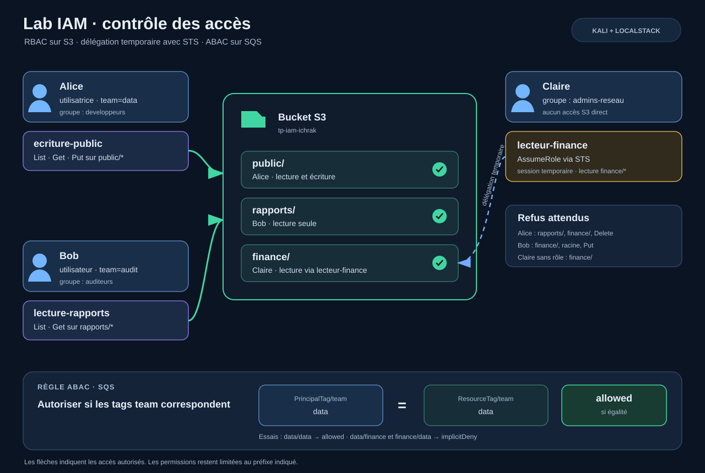

# AWS IAM Policies — RBAC & ABAC Access Control

Projet de démonstration AWS IAM et S3 réalisé sous Kali Linux avec LocalStack. Il présente des droits attachés à des groupes (RBAC), un rôle assumé temporairement via STS et une règle ABAC fondée sur des tags.

## Architecture



| Identité | Groupe ou rôle | Permissions démontrées |
|---|---|---|
| Alice | `developpeurs` | Lire et écrire dans `public/`; pas de suppression |
| Bob | `auditeurs` | Lire et lister `rapports/` uniquement |
| Claire | `admins-reseau`, puis `lecteur-finance` via STS | Aucun accès S3 direct ; lecture temporaire de `finance/` après AssumeRole |
| Alice | politique ABAC `abac-files` | Envoyer/recevoir SQS quand le tag `team` principal égale le tag `team` de la ressource |

Le compte de test LocalStack utilise `000000000000`. Les scripts récupèrent l’identifiant du compte automatiquement pour générer les ARNs nécessaires.

## Contenu

- `policies/` : six documents IAM séparés, commentés par leurs identifiants de déclaration.
- `scripts/` : préparation des objets S3, déploiement des politiques, tests d’accès, prise du rôle et simulation ABAC.
- `data/` : trois petits fichiers de démonstration.
- `architecture/architecture-iam.svg` : schéma complet de l’architecture.
- `docs/captures/` : captures choisies et renommées selon ce qu’elles montrent, dont la confirmation de l’appartenance de Claire à `admins-reseau`.
- `docs/matrice-tests.md` : résultats attendus et correspondance avec les captures.

## Prérequis

- Kali Linux, AWS CLI v2 et LocalStack démarré avec IAM activé (`ENFORCE_IAM=1`).
- LocalStack accessible à `http://localhost:4566`.
- Profils AWS CLI `admin`, `alice`, `bob` et `claire` déjà configurés. Les groupes `developpeurs` et `auditeurs` ainsi que ces utilisateurs doivent exister. Les captures incluses montrent cette configuration.
- Les permissions d’administration sur le profil `admin`.

Ne placez jamais de clés d’accès dans le dépôt. Les captures contenant des clés temporaires ont été exclues. Dans ce projet, le profil `claire-role` est temporaire et ses clés expirent ; le script dédié le recrée au moment de l’exécution.

## Déploiement depuis VS Code / Kali

Ouvrir le dossier du projet dans VS Code, puis utiliser un terminal Bash intégré. Si le dossier provient d’une archive, extraire le ZIP avant de l’ouvrir. Vérifier d’abord les profils :

```bash
aws --profile admin sts get-caller-identity
aws --profile alice sts get-caller-identity
aws --profile bob sts get-caller-identity
aws --profile claire sts get-caller-identity
```

Définir les paramètres si besoin puis exécuter les scripts dans l’ordre :

```bash
export AWS_ENDPOINT_URL=http://localhost:4566
export AWS_DEFAULT_REGION=eu-west-3
export BUCKET_NAME=tp-iam-ichrak
bash scripts/02-preparer-bucket.sh
bash scripts/01-deployer-politiques.sh
```

Le script d’installation crée les politiques managées `lecture-rapports` et `ecriture-public`, les attache aux groupes, crée le rôle `lecteur-finance`, pose sa politique inline et ajoute les autorisations STS à Claire et ABAC à Alice. Il suppose que les comptes et groupes mentionnés dans les prérequis existent.

Lancer les vérifications interactives :

```bash
bash scripts/03-tester-acces.sh
bash scripts/04-assumer-role-claire.sh
bash scripts/05-simuler-abac.sh
```

Dans le script de tests, des réponses `AccessDenied` sont normales pour les cas explicitement notés « refus attendu ». Le profil `claire-role` est configuré avec des identifiants temporaires, qui expirent.

## Politiques en résumé

- `lecture-rapports.json` : `ListBucket` limité au préfixe `rapports/*` et `GetObject` limité aux objets de ce préfixe.
- `ecriture-public.json` : liste, lit et écrit dans `public/*`; n’accorde pas `DeleteObject`.
- `confiance-lecteur-finance.json` : autorise uniquement Claire à appeler `sts:AssumeRole` sur ce rôle.
- `lecture-finance.json` : lecture du préfixe `finance/*` pour le rôle.
- `assume-lecteur-finance.json` : permission de Claire à assumer le rôle.
- `abac-files.json` : autorise les actions SQS seulement si les tags `team` du principal et de la ressource sont égaux.

## Principe du moindre privilège

Le scénario applique le moindre privilège pour les accès S3 démontrés :

- Alice peut lister, lire et déposer des objets dans `public/`, sans droit de suppression.
- Bob peut lister et lire `rapports/`, sans accès à `finance/` ni droit d’écriture.
- Claire n’a pas d’accès direct à `finance/` ; elle doit assumer `lecteur-finance`, dont les droits sont limités à la lecture de ce préfixe.

Deux limites sont à garder en tête :

- La politique ABAC utilise `"Resource": "*"` pour SQS. La condition sur les tags `team` restreint les accès évalués, mais une version plus stricte devrait aussi limiter la ressource à l’ARN de la file `analyses`.
- Les refus testés sont des refus implicites, dus à l’absence d’autorisation. Le scénario ne contient pas de `Deny` explicite ; une autre politique accordant des droits plus larges pourrait donc modifier le résultat.

La partie ABAC est évaluée par le simulateur IAM, sans création de file SQS. Ces résultats démontrent les règles du scénario, pas une configuration complète de défense en profondeur pour un compte AWS de production.

## Captures de preuve

Les captures sont renommées en français et indexées selon leur contenu. Les captures de commandes mal formées, de conflits Docker, de tentatives IAM échouées et celles qui exposaient les clés temporaires ont été écartées. Les refus montrés dans les captures de validation sont conservés parce qu’ils constituent les résultats de sécurité attendus.

Voir [la matrice de validation](docs/matrice-tests.md).

## Limites et nettoyage

Ce projet utilise LocalStack : ses réponses illustrent les règles testées, mais ne remplacent pas une validation dans un compte AWS réel. La partie ABAC est évaluée par le simulateur IAM et ne crée pas de file SQS. Les politiques accordent explicitement seulement les actions nécessaires aux exemples ; un refus observé peut aussi résulter de l’absence d’une permission.

Pour nettoyer, supprimer les objets et le bucket de test, puis retirer les politiques/groupes/rôle IAM créés selon votre environnement LocalStack. Ne lancez pas de suppression globale si d’autres exercices utilisent ce compte local.
